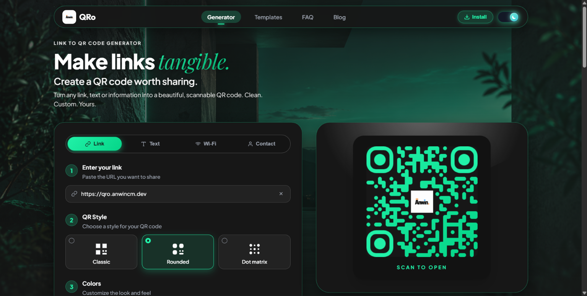

# QRo  Make Links Tangible

> Turn any link, text, Wi-Fi or contact information into a beautiful, scannable QR code. Clean. Custom. Yours.



## ✨ Features

- **Multi-Type Generation**: Supports standard **Links (URLs)**, **Plain Text**, **Wi-Fi credentials**, and **vCard Contacts**.
- **Modern QR Styles**:
  - **Classic**: Traditional square modules.
  - **Rounded**: Smooth, elegant organic rounded modules.
  - **Dot Matrix**: High-tech circular matrix modules.
- **Customizable Colors & Gradients**: Full hex color picker support with vibrant duo-tone linear gradients (e.g., Electric Blue to Deep Violet).
- **Logo Embed Support**: Custom logo upload (PNG, JPG, SVG) or curated sleek monogram badges with smart dot masking.
- **Frames & Typography Captions**: Optional frame with custom caption (e.g. `SCAN TO OPEN`) and typography selection.
- **Multi-Format High-Res Export**:
  - **PNG** (High quality raster with embedded frame & caption)
  - **SVG** (Infinite scale vector graphic)
  - **JPG**
  - **Copy to Clipboard** & Native **Share** sheet
- **Aesthetic Glassmorphic UI**: Ultra-modern frosted glass interface, ambient lighting, and dark/light mode toggle.

## 🚀 Getting Started

### Prerequisites

- Node.js (v16+)
- npm or yarn

### Installation

```bash
git clone https://github.com/Imperfect-spiker28/QR.git
cd QR
npm install --legacy-peer-deps
```

### Running Locally

```bash
npm start
```
Open [http://localhost:3000](http://localhost:3000) to view it in the browser.

### Building for Production

```bash
npm run build
```

### Environment Configuration

To enable Google Analytics 4 tracking in production:
```bash
REACT_APP_GA_MEASUREMENT_ID=G-XXXXXXXXXX
```

---

## 🌐 Official Website
- Live App: [https://qro.anwincm.dev/](https://qro.anwincm.dev/)

---

## 👨‍💻 Author

**Anwin C M**
- Portfolio: [anwincm.dev](https://anwincm.dev/)
- GitHub: [@Imperfect-spiker28](https://github.com/Imperfect-spiker28)
- LinkedIn: [Anwin C M](https://www.linkedin.com/in/anwincm/)
- Email: [anwincm8@gmail.com](mailto:anwincm8@gmail.com)

---

## 📄 License

This project is licensed under the MIT License.
